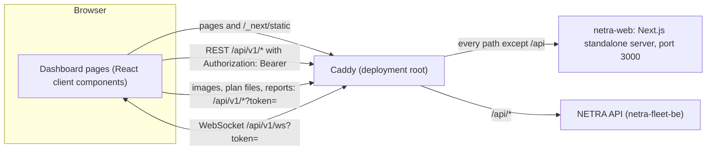

# Architecture

`netra-fleet-fe` is the dashboard of NETRA Fleet, the Patrol Command Center by EZRA Robotics for Pashupati patrol robots. It is a Next.js 14 App Router application published as the `netra-web` image. The login page and every signed-in page are client components: the browser talks to the NETRA API (`netra-fleet-be`) directly, over REST under `/api/v1` and one WebSocket, on the same origin as the dashboard. The Next.js server only serves pages and static assets.

## Data flow



- REST calls go through `request()` in [`src/lib/api.ts`](../src/lib/api.ts) with the session token as a bearer header.
- Elements that cannot send headers (``, the SVG `<image>` of a floor plan, report and export links) carry the token in the query string (`withToken`).
- The live connection in [`src/lib/live.tsx`](../src/lib/live.tsx) opens `ws(s)://<page host>/api/v1/ws?token=<token>`.
- Robot data reaches the dashboard only through the API: REST for stored data, the WebSocket for telemetry and events.
- In development the Next.js dev server takes the place of Caddy for `/api` (see [development](development.md#run-against-an-api)).

## Stack

From [`package.json`](../package.json):

| Package                                           | Version                   | Role                                                                                               |
| ------------------------------------------------- | ------------------------- | -------------------------------------------------------------------------------------------------- |
| `next`                                            | 14.2.15                   | App Router, standalone server                                                                      |
| `react`, `react-dom`                              | 18.3.1                    | UI                                                                                                 |
| `pdfjs-dist`                                      | 4.7.76                    | Renders page 1 of a PDF floor plan to PNG before upload (imported on demand)                       |
| `typescript`                                      | 5.6.3                     | Strict mode with `noUncheckedIndexedAccess`                                                        |
| `tailwindcss`, `postcss`, `autoprefixer`          | 3.4.14, 8.4.47, 10.4.20   | Styling; the palette is driven by CSS variables                                                    |
| `eslint`, `eslint-config-next`                    | ^8.57.1, ^14.2.15         | `next lint`                                                                                        |
| `prettier`, `prettier-plugin-tailwindcss`         | ^3.3.3, ^0.6.8            | Formatting (the plugin is not loaded, see [development](development.md#lint-format-and-typecheck)) |
| `@types/node`, `@types/react`, `@types/react-dom` | 20.16.11, 18.3.11, 18.3.1 | Type definitions                                                                                   |

There are no chart, map or state-management libraries: the floor plan, map layers and charts are plain SVG, and shared state lives in React context providers.

## Build output and Docker image

[`next.config.mjs`](../next.config.mjs):

- `output: 'standalone'`: `next build` writes a self-contained server to `.next/standalone` (`server.js` and the `node_modules` it needs).
- `reactStrictMode: true` and `poweredByHeader: false`.
- `rewrites()`: when `NETRA_API_URL` is set, `/api/:path*` is proxied to `${NETRA_API_URL}/api/:path*`; otherwise there are no rewrites.

[`Dockerfile`](../Dockerfile), three stages on `node:20-alpine`:

| Stage   | What it does                                                                                                                                                                                                                      |
| ------- | --------------------------------------------------------------------------------------------------------------------------------------------------------------------------------------------------------------------------------- |
| `deps`  | `npm ci --no-audit --no-fund --ignore-scripts` from `package.json` and `package-lock.json`                                                                                                                                        |
| `build` | Copies `node_modules` and the source, runs `npm run postinstall` (copies the PDF.js worker to `public/`) and `npm run build`                                                                                                      |
| runtime | Sets `NODE_ENV=production`, `PORT=3000`, `HOSTNAME=0.0.0.0`; copies `.next/standalone` to `/app`, `.next/static` to `/app/.next/static` and `public` to `/app/public`; runs as `node`; `EXPOSE 3000`; `CMD ["node", "server.js"]` |

[`.dockerignore`](../.dockerignore) excludes `node_modules`, `.next`, `.git`, `.github`, `public/pdf.worker.min.mjs`, `*.tsbuildinfo` and `README.md`, so nothing from a host install reaches the image. CI publishes the image as `ghcr.io/<owner>/netra-web` for `linux/amd64` and `linux/arm64` (see [development](development.md#ci)).

## Environment variables

| Variable         | Read by                                     | When                                                                                                  | Default                         | Effect                                                                  |
| ---------------- | ------------------------------------------- | ----------------------------------------------------------------------------------------------------- | ------------------------------- | ----------------------------------------------------------------------- |
| `NEXT_PUBLIC_TZ` | [`src/lib/format.ts`](../src/lib/format.ts) | Inlined into the client bundle by `next build` and `next dev`                                         | `Asia/Jakarta`                  | IANA time zone of every date and time formatted by `useFmt()`           |
| `NETRA_API_URL`  | [`next.config.mjs`](../next.config.mjs)     | When `next dev` starts, and at `next build` (a built server reads its rewrites from the build output) | unset                           | API base URL for the `/api` rewrite, without a trailing slash or `/api` |
| `PORT`           | `server.js` generated by Next.js            | Runtime                                                                                               | `3000` (set in the image)       | Listening port                                                          |
| `HOSTNAME`       | `server.js` generated by Next.js            | Runtime                                                                                               | `0.0.0.0` (set in the image)    | Listening address                                                       |
| `NODE_ENV`       | Next.js                                     | Runtime                                                                                               | `production` (set in the image) | Production mode                                                         |

`NEXT_PUBLIC_TZ` is the only variable read in `src/`. The Dockerfile passes neither it nor `NETRA_API_URL` to the build, so the published image formats times in `Asia/Jakarta` and contains no rewrite: in production `/api` must be routed by Caddy. Changing the time zone of the image needs a rebuild with `NEXT_PUBLIC_TZ` set during `npm run build`.

## Source layout

```text
src/
├── app/
│   ├── layout.tsx            Root layout (server component): metadata, theme script, ThemeProvider, I18nProvider
│   ├── page.tsx              "/" redirects to /dashboard on the server
│   ├── globals.css           Theme variables, base table styles, reduced-motion rule
│   ├── login/page.tsx        Sign-in form
│   └── (dashboard)/          Route group of the signed-in pages (the group name is not part of the URL)
│       ├── layout.tsx        Token check, MeProvider, LiveProvider, AppShell
│       ├── dashboard/        Wall overview
│       │   ├── _components/  Readouts, LiveMap, Attention, Fleet, Activity, TodayCharts, chart helpers
│       │   └── _lib/         overview.ts (data hooks), attention.ts (robot issues), stops.ts (stop numbering)
│       ├── map/              Operations map; _components/RobotCard.tsx, _components/EventFeed.tsx
│       ├── anomalies/        Gallery; [id]/ detail with operator validation
│       ├── patrols/          History; [id]/ recap
│       ├── schedules/        Weekly and one-off patrol schedules
│       ├── routes/           Route database
│       ├── crowd/            Crowd heatmap and peaks
│       ├── reports/          Report and export downloads
│       ├── floor-plans/      Upload and calibration; _components/readPlanFile.ts
│       ├── robots/[id]/      Robot detail and track replay
│       ├── settings/         Robots and tokens, anomaly rules, API clients
│       ├── users/            Accounts and roles
│       └── audit/            Audit log
├── components/
│   ├── AppShell.tsx          Sidebar, header, password dialog; HeaderToggles (theme and language)
│   ├── ui.tsx                UI primitives
│   ├── icons.tsx             Inline SVG icons
│   ├── FloorPlanView.tsx     Pan and zoom viewer of a floor plan, marker scale context
│   ├── GridMapView.tsx       Metric grid in the robot map frame
│   ├── MapLayers.tsx         SVG overlays for FloorPlanView: route, trail, robot, anomaly, heat
│   ├── RobotControls.tsx     AI inspection, people detection and computer load of a robot
│   └── BarChart.tsx          Minimal SVG bar chart (crowd page)
├── i18n/
│   ├── en.ts                 English dictionary, the source of truth for keys
│   ├── id.ts                 Indonesian dictionary, type-checked against en.ts
│   ├── types.ts              Messages, MessageKey, Locale
│   └── index.tsx             I18nProvider, useI18n (t, tx, intl)
└── lib/
    ├── api.ts                REST client, session token, withToken
    ├── types.ts              API and WebSocket message types
    ├── live.tsx              LiveProvider, useLive (WebSocket state)
    ├── session.tsx           MeProvider, useMe (current user, permission check)
    ├── hooks.ts              useAsync, useRules
    ├── format.ts             useFmt, range presets
    ├── geometry.ts           Map frame to plan pixel transform
    ├── labels.ts             Status to tone mappings, alarm states, weekday keys
    ├── theme.tsx             ThemeProvider, useTheme, themeScript
    └── clipboard.ts          copyText with a fallback for plain HTTP
```

Folders starting with `_` hold page-private code and are not routes. Outside `src/`, `public/logos/ezra.svg` is a text placeholder for the EZRA logo, and `public/pdf.worker.min.mjs` is copied from `pdfjs-dist` by the `postinstall` script (git-ignored).

## Pages

[`AppShell.tsx`](../src/components/AppShell.tsx) hides the navigation items a user may not open, and pages hide controls with `useMe().can(...)`. API paths are relative to `/api/v1`; paths marked "links" are URLs for images, files and reports rather than requests.

| Path                                                                  | Purpose                                                                                                                                                                                   | Permission                                                                             | Main API calls                                                                                                                                                                                                                                                                                    |
| --------------------------------------------------------------------- | ----------------------------------------------------------------------------------------------------------------------------------------------------------------------------------------- | -------------------------------------------------------------------------------------- | ------------------------------------------------------------------------------------------------------------------------------------------------------------------------------------------------------------------------------------------------------------------------------------------------- |
| [`/login`](../src/app/login/page.tsx)                                 | Sign-in form with theme and language switches; stores the token and opens `/dashboard`                                                                                                    | None                                                                                   | `POST /auth/login`                                                                                                                                                                                                                                                                                |
| [`/`](../src/app/page.tsx)                                            | Server-side redirect to `/dashboard`                                                                                                                                                      | None                                                                                   | None                                                                                                                                                                                                                                                                                              |
| [`/dashboard`](<../src/app/(dashboard)/dashboard/page.tsx>)           | Start page and wall display: readouts, live map (plan or grid) with trails and follow mode, needs-attention queue, fleet with commands, activity log, today's patrols, findings and crowd | Nav `view`; `operate` for fleet commands, e-stop release, Confirm and Reject           | `GET /robots`, `/floorplans`, `/routes`, `/routes/{id}`, `/patrols`, `/anomalies` (today, last 24 h, `needs_validation` of 30 days), `/events`, `/crowd/timeline`, `/crowd/heatmap`, `/robots/{id}/track`, `/info`, `/rules`; `POST /robots/{id}/command`, `/patrols`, `/anomalies/{id}/validate` |
| [`/map`](<../src/app/(dashboard)/map/page.tsx>)                       | Operations map: plan or grid, layer switches, route picker, fleet cards with commands and live controls, pending count, live event feed                                                   | Nav `view`; `operate` for commands and controls                                        | `GET /robots`, `/floorplans`, `/anomalies` (24 h), `/routes`, `/routes/{id}`, `/crowd/heatmap`, `/rules`, `/inspection/models`; `POST /robots/{id}/command`, `/robots/{id}/inspection`, `/robots/{id}/people`                                                                                     |
| [`/anomalies`](<../src/app/(dashboard)/anomalies/page.tsx>)           | Gallery with status tabs, category filter, range presets and Excel export                                                                                                                 | Nav `view`                                                                             | `GET /anomalies`, `/rules`; links `/anomalies/{id}/image`, `/reports/anomalies`                                                                                                                                                                                                                   |
| [`/anomalies/[id]`](<../src/app/(dashboard)/anomalies/[id]/page.tsx>) | Photo, early and final detection, position on the plan with its route, operator validation                                                                                                | Not in the nav; `operate` for validation                                               | `GET /anomalies/{id}`, `/robots`, `/floorplans`, `/routes/{id}`, `/rules`; `POST /anomalies/{id}/validate`                                                                                                                                                                                        |
| [`/patrols`](<../src/app/(dashboard)/patrols/page.tsx>)               | History by range and robot, Excel export, PDF per patrol, start a patrol                                                                                                                  | Nav `view`; `operate` for the start panel                                              | `GET /patrols`, `/robots`, `/routes`; `POST /patrols`; links `/reports/patrols`, `/reports/patrols/{id}/pdf`                                                                                                                                                                                      |
| [`/patrols/[id]`](<../src/app/(dashboard)/patrols/[id]/page.tsx>)     | Recap: figures, plan with route and anomaly pins, anomalies by category, event timeline, PDF, stop                                                                                        | Not in the nav; `operate` for Stop                                                     | `GET /patrols/{id}`, `/events?patrol_id=`, `/anomalies?patrol_id=`, `/routes/{id}`, `/robots`, `/floorplans`, `/rules`; `POST /patrols/{id}/stop`                                                                                                                                                 |
| [`/schedules`](<../src/app/(dashboard)/schedules/page.tsx>)           | Weekly or one-off patrol schedules and their editor                                                                                                                                       | Nav `view`; `operate` to create, edit, enable and delete                               | `GET /schedules`, `/robots`, `/routes`; `POST /schedules`; `PUT` and `DELETE /schedules/{id}`                                                                                                                                                                                                     |
| [`/routes`](<../src/app/(dashboard)/routes/page.tsx>)                 | Recorded routes with a switch for archived ones; rename, archive or restore, CSV download, preview on the plan                                                                            | Nav `view`; `configure` to rename and archive                                          | `GET /routes`, `/routes/{id}`, `/robots`, `/floorplans`; `PUT /routes/{id}`; `GET /routes/{id}/file` (direct `fetch`)                                                                                                                                                                             |
| [`/crowd`](<../src/app/(dashboard)/crowd/page.tsx>)                   | Heatmap (peak or mean), figures, peaks per hour or per day, busiest hours                                                                                                                 | Nav `view`                                                                             | `GET /crowd/heatmap`, `/crowd/timeline`, `/floorplans`                                                                                                                                                                                                                                            |
| [`/reports`](<../src/app/(dashboard)/reports/page.tsx>)               | Period, robot and report language; summary PDF or Excel, anomaly and patrol Excel lists                                                                                                   | Nav `view`                                                                             | `GET /robots`; links `/reports/summary`, `/reports/anomalies`, `/reports/patrols`                                                                                                                                                                                                                 |
| [`/floor-plans`](<../src/app/(dashboard)/floor-plans/page.tsx>)       | Upload SVG, PNG, JPG or PDF; calibrate base point, rotation and scale; preview a route; assign robots; delete                                                                             | Nav `configure`                                                                        | `GET /floorplans`, `/robots`, `/routes`, `/routes/{id}`; `POST /floorplans`; `PUT` and `DELETE /floorplans/{id}`; `PUT /robots/{id}`                                                                                                                                                              |
| [`/robots/[id]`](<../src/app/(dashboard)/robots/[id]/page.tsx>)       | Live controls and load, load history, track replay (1x, 4x, 16x), battery and people charts                                                                                               | Not in the nav; `operate` for controls                                                 | `GET /robots/{id}/track`, `/robots`, `/floorplans`, `/inspection/models`; `POST /robots/{id}/inspection`, `/robots/{id}/people`                                                                                                                                                                   |
| [`/settings`](<../src/app/(dashboard)/settings/page.tsx>)             | Robots (add with a one-time token, rename, new token, delete), anomaly category rules, API clients of the integration API (`/api/ext/v1`)                                                 | Nav `configure`; `users` for the API clients panel                                     | `GET /robots`, `/info`, `/rules`, `/api-clients`; `POST /robots`, `/robots/{id}/token`, `/api-clients`, `/api-clients/{id}/secret`; `PUT /robots/{id}`, `/rules/{category}`, `/api-clients/{id}`; `DELETE` on the same three resources                                                            |
| [`/users`](<../src/app/(dashboard)/users/page.tsx>)                   | Accounts: display name, role, enable or disable, reset password, delete, add; role descriptions                                                                                           | Nav `users`; on the signed-in user's own row, role, disable and delete are unavailable | `GET` and `POST /users`; `PUT` and `DELETE /users/{id}`; `POST /users/{id}/password`                                                                                                                                                                                                              |
| [`/audit`](<../src/app/(dashboard)/audit/page.tsx>)                   | Audit log by range, filtered by user                                                                                                                                                      | Nav `audit`                                                                            | `GET /audit`                                                                                                                                                                                                                                                                                      |

The shell adds `GET /me`, the WebSocket, `POST /me/password` (password dialog) and `POST /auth/logout` on every signed-in page.

## App shell

Provider nesting:

```text
RootLayout (server)        src/app/layout.tsx
└── ThemeProvider          src/lib/theme.tsx
    └── I18nProvider       src/i18n/index.tsx
        ├── /login
        └── DashboardLayout  src/app/(dashboard)/layout.tsx
            └── MeProvider     src/lib/session.tsx
                └── LiveProvider  src/lib/live.tsx
                    └── AppShell     src/components/AppShell.tsx
                        └── page
```

[`DashboardLayout`](<../src/app/(dashboard)/layout.tsx>) checks for a token in `localStorage` after mount: without one it replaces the URL with `/login`, otherwise it renders the providers. It renders nothing until that check, so signed-in pages are never rendered on the server.

### Sidebar

| Section        | Items (path, permission)                                                                                                                                       |
| -------------- | -------------------------------------------------------------------------------------------------------------------------------------------------------------- |
| Operations     | Dashboard `/dashboard` (`view`), Operations map `/map` (`view`), Anomalies `/anomalies` (`view`), Patrols `/patrols` (`view`), Schedules `/schedules` (`view`) |
| Data           | Routes `/routes` (`view`), Crowd `/crowd` (`view`), Reports `/reports` (`view`), Floor plans `/floor-plans` (`configure`)                                      |
| Administration | Settings `/settings` (`configure`), Users `/users` (`users`), Audit log `/audit` (`audit`)                                                                     |

- The active item is the one whose path is a prefix of the current pathname, so detail pages highlight their list.
- The footer shows the display name (or username) and role, a change-password dialog (at least 8 characters) and log out (`POST /auth/logout`, clear the token, go to `/login`).
- On wide screens (`(min-width: 1024px)`, Tailwind `lg`) the sidebar is docked or hidden, remembered in `netra.sidebar`. On narrower screens it opens as a drawer over the page, closing on navigation, on Escape and on the backdrop.
- The header button and the `[` key toggle it. The key is ignored while typing in an input, text area, select or editable element, and with Ctrl, Alt or Meta.

### Header

From left to right: sidebar button; the NETRA wordmark when the sidebar is hidden on a wide screen; the EZRA logo (`/logos/ezra.svg`); a connection dot with Live or Offline (`useLive().connected`); robots online (robots whose `useLive().online` entry is true); a clock with seconds (from 1280 px, always `Asia/Jakarta`); a full-screen button where `document.fullscreenEnabled` is true; `HeaderToggles` with the theme switch and the EN/ID language switch. The login page shows the same `HeaderToggles`.

### Wall layout

[`tailwind.config.ts`](../tailwind.config.ts) defines the screen `wall` as `(min-width: 1280px) and (min-height: 700px)`. On such a screen the dashboard page becomes a fixed-height grid, `wall:h-[calc(100dvh-3.0625rem-1.5rem)]` (the viewport minus the 3 rem header with its 1 px border and the page padding): readouts across the top, the live map on the left, a 22 to 25 rem column with Attention, Fleet and Activity on the right, and today's charts under the map. Below that size the dashboard stacks and scrolls. Paths in `DENSE` in `AppShell.tsx` (only `/dashboard`) get the thin `p-2 sm:p-3` margin instead of `p-4 sm:p-6`.

### Permissions

[`MeProvider`](../src/lib/session.tsx) loads `GET /me` (`Me`: `username`, `display_name`, `role`, `permissions`, `timezone`). `useMe()` returns `{ me, can }`, where `can(p)` is true when `me.permissions` contains `p`.

- Permissions are `view`, `operate`, `configure`, `audit` and `users`; roles are `viewer`, `operator`, `supervisor` and `admin`. The API decides which permissions a role has; the dashboard only reads the list. The role descriptions on the users page (`users.roleHelp`) read: viewer reads every page; operator runs patrols, commands robots and validates anomalies; supervisor is operator plus robots, rules, floor plans and the audit log; admin is everything including users.
- Navigation items are filtered with `can(item.perm)`; a section without visible items is not shown.
- Controls are hidden with `can(...)`, mostly `can('operate')`, and robot commands also need the robot online.
- Until `/me` answers, `can` returns false, so navigation and controls appear once it has loaded.
- Routes are not guarded in the browser: a hidden page opened by URL renders and relies on the API to refuse what the role may not do; the error appears through `ErrorNote`.

## Data layer

### REST client

[`src/lib/api.ts`](../src/lib/api.ts):

- `session` reads, writes and clears the token in `localStorage` under `netra.token`.
- `request<T>(path, init)`:
  1. Prefixes `/api/v1` to the path.
  2. Adds `Authorization: Bearer <token>` when a token exists.
  3. Sets `Content-Type: application/json` when there is a body that is not `FormData`.
  4. On 401 for a path that does not start with `/auth`, clears the token and navigates to `/login` with a full page load (`window.location.href`), then still throws.
  5. On any other non-2xx status, throws `ApiError(status, message)`, where the message is the body's `error`, else `msg`, else the status text.
  6. For 202 and 204, parses the body only when there is one; other successful responses are parsed as JSON.
- `json(method, body)` builds the `RequestInit`; `query(params, range)` drops `undefined`, `null` and empty values and adds `from` and `to` as ISO strings from a `Range` (`{ from: Date; to: Date }`).
- `withToken(path)` returns `/api/v1<path>?token=<token>` (or `&token=`) for URLs used by ``, the SVG `<image>` and download links. `anomalies.imageUrl`, `floorPlans.fileUrl` and every `reports.*` function use it, so the token appears in those URLs.

`api` groups the endpoints by resource:

| Group                 | Functions and endpoints                                                                                                                                                                                                                                                                                                                             |
| --------------------- | --------------------------------------------------------------------------------------------------------------------------------------------------------------------------------------------------------------------------------------------------------------------------------------------------------------------------------------------------- |
| Session and server    | `login` `POST /auth/login`, `logout` `POST /auth/logout`, `me` `GET /me`, `changePassword` `POST /me/password`, `info` `GET /info` (public URL and time zone; older servers answer 404), `inspectionModels` `GET /inspection/models`                                                                                                                |
| `robots`              | `list` `GET /robots`, `create` `POST /robots` (answers the token), `update` `PUT /robots/{id}`, `remove` `DELETE /robots/{id}`, `rotateToken` `POST /robots/{id}/token`, `inspection` and `people` `POST /robots/{id}/inspection` and `/people` (answer the robot's `Ack`), `command` `POST /robots/{id}/command`, `track` `GET /robots/{id}/track` |
| `users`, `audit`      | `list`, `create`, `update`, `remove`, `resetPassword` on `/users` and `/users/{id}`; `audit` `GET /audit`                                                                                                                                                                                                                                           |
| `apiClients`          | `list`, `create`, `update`, `rotateSecret`, `remove` on `/api-clients` and `/api-clients/{id}`; create and rotate answer the secret once                                                                                                                                                                                                            |
| `reports`             | URL builders, not requests: `patrolPdf` `/reports/patrols/{id}/pdf`, `summary` `/reports/summary` (PDF or XLSX), `anomalies` `/reports/anomalies`, `patrols` `/reports/patrols`; all take a `lang`                                                                                                                                                  |
| `routes`, `schedules` | `routes.list` `GET /routes`, `get` `GET /routes/{id}` (with points), `update` `PUT /routes/{id}`; `schedules.list`, `save` (`POST` without id, `PUT` with id), `remove`                                                                                                                                                                             |
| `patrols`, `events`   | `patrols.list` `GET /patrols`, `get` `GET /patrols/{id}` (patrol and recap), `start` `POST /patrols`, `stop` `POST /patrols/{id}/stop`; `events` `GET /events` by robot or patrol                                                                                                                                                                   |
| `anomalies`, `rules`  | `anomalies.list` `GET /anomalies`, `get`, `validate` `POST /anomalies/{id}/validate`, `imageUrl`; `rules.list` `GET /rules`, `save` `PUT /rules/{category}`, `remove` `DELETE /rules/{category}`                                                                                                                                                    |
| `crowd`, `floorPlans` | `crowd.heatmap` `GET /crowd/heatmap`, `timeline` `GET /crowd/timeline` (hour or day buckets); `floorPlans.list`, `upload` (multipart `POST /floorplans`), `calibrate` `PUT /floorplans/{id}`, `remove`, `fileUrl`                                                                                                                                   |

Three places reach the API without `api`: the CSV download on the routes page (`fetch` of `/api/v1/routes/{id}/file` with the bearer header, saved through a blob URL), the WebSocket in `live.tsx`, and the API docs link `/api/ext/docs` on the settings page. Types for every response and message are in [`src/lib/types.ts`](../src/lib/types.ts), with the API's snake_case field names.

### Hooks

`useAsync(load, deps)` in [`src/lib/hooks.ts`](../src/lib/hooks.ts) returns `{ data, error, loading, reload }`:

- It runs `load` on mount and whenever `deps` change, and ignores the result of a superseded run or of an unmounted component.
- It keeps the previous `data` while reloading and after an error, and clears `error` on success.
- `reload()` runs it again with the same deps.
- `load` is memoised on `deps` only (the exhaustive-deps lint rule is disabled there), so every value it reads must be in `deps`.

```tsx
const { revision } = useLive();
const robots = useAsync(() => api.robots.list(), [revision]);
```

Other shared hooks:

| Hook                                  | Source                                                                                                              | Returns                                                                                                                                                                                                           |
| ------------------------------------- | ------------------------------------------------------------------------------------------------------------------- | ----------------------------------------------------------------------------------------------------------------------------------------------------------------------------------------------------------------- |
| `useRules()`                          | [`hooks.ts`](../src/lib/hooks.ts)                                                                                   | `GET /rules` plus `label(category)`: the built-in `trash`, `spill`, `floor_damage`, `fallen_person` and `unknown` use `category.*` translations, others the rule label, else the code with spaces for underscores |
| `useCalibratedPlan(preferred)`        | [`hooks.ts`](../src/lib/hooks.ts)                                                                                   | `{ plan, calibrated, loaded }`: the floor plan to draw on, see [Plan or grid](#plan-or-grid)                                                                                                                      |
| `useMe()`                             | [`session.tsx`](../src/lib/session.tsx)                                                                             | Current user and `can(permission)`                                                                                                                                                                                |
| `useLive()`                           | [`live.tsx`](../src/lib/live.tsx)                                                                                   | Live state, see below                                                                                                                                                                                             |
| `useI18n()`, `useTheme()`, `useFmt()` | [`i18n/index.tsx`](../src/i18n/index.tsx), [`theme.tsx`](../src/lib/theme.tsx), [`format.ts`](../src/lib/format.ts) | Translation, theme, formatters                                                                                                                                                                                    |

The dashboard has its own data hooks in [`dashboard/_lib/overview.ts`](<../src/app/(dashboard)/dashboard/_lib/overview.ts>):

- `useOverview()` runs every dashboard query: robots, routes, patrols and anomalies refetch on `revision`; the "today" queries roll over at midnight (a day key checked every minute); the crowd timeline refreshes on `crowd` messages at most every 30 s; plans, server info and stored events load once (events again at midnight).
- `useTrails(ids)` starts each robot's trail with 5 minutes of `/robots/{id}/track` and appends live poses; a trail keeps at most 150 points and 80 m, and moves under 5 cm are skipped.
- `usePatrolProgress(telemetry)` keeps the last stop index of each running patrol, from its stored `stop_event`s and then live ones.
- `useRoutePoints(ids)` fetches the points of each route once.
- `useFreshAnomalies()` returns the ids of `anomaly` messages with status `queued` from the last 15 s, for the ripple on the map.

### Live WebSocket

`LiveProvider` in [`src/lib/live.tsx`](../src/lib/live.tsx) is mounted by the dashboard layout and opens one WebSocket per tab:

- URL: `ws://` or `wss://` (following the page protocol), the page host, `/api/v1/ws?token=<token>`. The token is read again on each attempt.
- `connected` is true between open and close. After a close it reconnects after a fixed 3 s, until the provider unmounts (log out or leaving the signed-in pages).
- Every frame is parsed as a `LiveMessage`, applied to the state below, then passed to every listener registered with `subscribe(fn)`, which returns its unsubscribe function.

| State       | Meaning                                                                    |
| ----------- | -------------------------------------------------------------------------- |
| `connected` | Socket open                                                                |
| `telemetry` | Latest `Telemetry` per robot id                                            |
| `online`    | Online flag per robot id, for robots heard from since the provider mounted |
| `revision`  | Counter that increases on changes pages should refetch for                 |
| `subscribe` | Register a listener for every message                                      |

| Message            | Payload                                                        | Provider effect                                      | Used by                                                                                                              |
| ------------------ | -------------------------------------------------------------- | ---------------------------------------------------- | -------------------------------------------------------------------------------------------------------------------- |
| `telemetry`        | `robot_id`, `data: Telemetry`                                  | Stores `telemetry[robot_id]`, marks the robot online | Maps, fleet, robot controls (pose, navigation state, battery, people, health, e-stop, field, detectors); `useTrails` |
| `robot_online`     | `robot_id`, `online`                                           | Stores `online[robot_id]`                            | Header count, dashboard activity, map event feed                                                                     |
| `anomaly`          | `id`, `status`, `category?`, `robot_id?`                       | `revision` + 1                                       | Refetches; `useFreshAnomalies` and activity (`queued`); event feed (`queued`, `needs_validation`)                    |
| `route`            | `robot_id`, `id`                                               | `revision` + 1                                       | Refetches                                                                                                            |
| `patrol_event`     | `robot_id`, `data` (`event`, `lap`)                            | `revision` + 1                                       | Refetches; activity, event feed                                                                                      |
| `patrol_requested` | `robot_id`, `patrol_id`                                        | `revision` + 1                                       | Refetches                                                                                                            |
| `ack`              | `robot_id`, `data`                                             | `revision` + 1                                       | Refetches                                                                                                            |
| `stop_event`       | `robot_id`, `data` (`event`, `index`, `route_id`, `patrol_id`) | None                                                 | Activity, event feed, `usePatrolProgress`                                                                            |
| `alert`            | `robot_id`, `data.state` (navigation state)                    | None                                                 | Activity, event feed                                                                                                 |
| `crowd`            | `robot_id`, `data`                                             | None                                                 | Crowd timeline refresh in `useOverview`                                                                              |
| `hello`            | `robot_id`, `data`                                             | None                                                 | Not handled                                                                                                          |

Pages that show server data add `revision` to their `useAsync` deps (dashboard, map, anomalies list, patrols list and detail, routes), so any of the `revision` messages refetches them. Robot state comes from the socket with the REST value as fallback, for example `online[id] ?? robot.online` and `telemetry[id] ?? robot.last_telemetry`. Listeners subscribe in an effect:

```tsx
const { subscribe } = useLive();
useEffect(
  () =>
    subscribe((msg) => {
      if (msg.type === 'stop_event') console.log(msg.robot_id, msg.data.index);
    }),
  [subscribe],
);
```

### Browser storage

| Key                      | Written by                                                          | Value                                       |
| ------------------------ | ------------------------------------------------------------------- | ------------------------------------------- |
| `netra.token`            | [`api.ts`](../src/lib/api.ts)                                       | Session token                               |
| `netra.theme`            | [`theme.tsx`](../src/lib/theme.tsx)                                 | `dark` or `light`                           |
| `netra.locale`           | [`i18n/index.tsx`](../src/i18n/index.tsx)                           | `en` or `id`                                |
| `netra.sidebar`          | [`AppShell.tsx`](../src/components/AppShell.tsx)                    | `docked` or `hidden`                        |
| `netra.dashboard.layers` | [`dashboard/page.tsx`](<../src/app/(dashboard)/dashboard/page.tsx>) | JSON of the dashboard map layer switches    |
| `netra.map.mode`         | [`map/page.tsx`](<../src/app/(dashboard)/map/page.tsx>)             | `plan` or `grid`                            |
| `netra.map.route`        | [`map/page.tsx`](<../src/app/(dashboard)/map/page.tsx>)             | Id of the route shown on the operations map |

## Maps

### Coordinates and calibration

Robot poses, routes, anomaly positions and crowd cells are in the robot's map frame, in metres with y up; the calibration hint describes x as the robot's forward direction when mapping started and y as its left. A floor plan is an image in pixels with y down. `FloorPlan` stores the calibration: `origin_x_px` and `origin_y_px` (the plan pixel of the map origin, the robot base), `px_per_m` and `rotation_rad`.

[`src/lib/geometry.ts`](../src/lib/geometry.ts):

- `mapToPlan(plan, x, y)` computes `p = origin + s · R(θ) · (x, −y)` with `s = px_per_m` and `θ = rotation_rad`, that is `px = ox + s(x cos θ + y sin θ)` and `py = oy + s(x sin θ − y cos θ)`.
- `planToMap(plan, px, py)` is the inverse (not used at the moment).
- `planHeadingDeg(plan, yaw)` is `(θ − yaw) · 180 / π`, the SVG rotation of a heading arrow on the plan.

A plan with `px_per_m` of 0 or less is uncalibrated: `mapToPlan` would put every point on the base point.

The [floor plans page](<../src/app/(dashboard)/floor-plans/page.tsx>) creates and calibrates plans:

- Upload: [`readPlanFile`](<../src/app/(dashboard)/floor-plans/_components/readPlanFile.ts>) takes the size of an SVG from its `viewBox` or `width` and `height`, of a PNG or JPG from the image, and renders page 1 of a PDF at scale 2 to a PNG with `pdfjs-dist` (worker `/pdf.worker.min.mjs`). It then sends `POST /floorplans` as multipart form data (`file`, `name` from the file name, `width_px`, `height_px`).
- Mode 1, robot base: a click sets the origin.
- Mode 2, scale: click two points, enter their distance in metres and apply; `px_per_m` becomes the pixel distance divided by the metres.
- Pan and view: clicks do nothing.
- Rotation is a slider from −180° to 180° in 0.5° steps; base X, base Y and scale are also numeric inputs.
- The overlay draws 1 m of the map x axis in red and of the y axis in green from the BASE point, and can show a recorded route to check the fit.
- Save sends the whole plan with `PUT /floorplans/{id}`; robots are assigned with `PUT /robots/{id}` (`floor_plan_id`).

### FloorPlanView

[`FloorPlanView`](../src/components/FloorPlanView.tsx) shows the plan image (`floorPlans.fileUrl`) in an SVG whose `viewBox` is in plan pixels; children are overlays in plan pixels.

| Prop          | Meaning                                                                                                                                                 |
| ------------- | ------------------------------------------------------------------------------------------------------------------------------------------------------- |
| `plan`        | The `FloorPlan`                                                                                                                                         |
| `children`    | SVG overlays, usually from `MapLayers`                                                                                                                  |
| `onPlanClick` | Called with plan pixel coordinates on a click that is not a drag (calibration)                                                                          |
| `onUserMove`  | Called when the person pans or zooms (the dashboard stops following a robot)                                                                            |
| `focus`       | `{ px, py, w? }` to centre the view on, optionally with a view width (dashboard follow mode)                                                            |
| `variant`     | `dimmed` (default: plan at 85 % opacity on navy), `night` (light plan inverted into a dark map by an SVG filter that keeps hues), `day` (plan as drawn) |
| `className`   | Size of the viewer (default `h-[560px]`)                                                                                                                |

- The wheel zooms by 1.15 per step around the pointer, with the view width kept between 1/40 and 4 times the plan width; the + and − buttons zoom by 1.4 and the reset button shows the whole plan.
- Dragging pans; pointer capture starts only after 3 px of movement, so a click still reaches markers and pins.
- `useMarkerScale(pxPerM)` returns plan pixels per screen pixel inside a viewer, so symbols keep the same size on screen at any zoom; outside a viewer it falls back to `max(pxPerM / 20, 0.6)`. `useMapDay()` is true on the `day` variant, where overlays use darker colours.

### Map layers

[`MapLayers.tsx`](../src/components/MapLayers.tsx) components take the `plan` and draw through `mapToPlan`:

| Component     | Draws                                                                                                                                 |
| ------------- | ------------------------------------------------------------------------------------------------------------------------------------- |
| `RouteLayer`  | Route polyline and numbered stops; `RoutePoint` is `[x, y, yawDeg, dwellSec]` and a stop is a point with a dwell time above 0         |
| `TrailLayer`  | Recent positions as segments that fade with age                                                                                       |
| `RobotMarker` | Heading arrow, name, pulse; tone `ok`, `warn`, `danger` or `idle` (or `alarm` for danger); a selection ring; a sweep while inspecting |
| `AnomalyPin`  | Warning triangle, amber while waiting for validation (with a pulse), red otherwise, a ripple when `fresh`                             |
| `HeatLayer`   | Crowd cells as squares rotated with the plan, coloured cyan, green, amber, red by peak or mean relative to the maximum                |
| `HeatLegend`  | The colour scale with its maximum (HTML, outside the SVG)                                                                             |

### GridMapView

[`GridMapView`](../src/components/GridMapView.tsx) replaces the plan when there is no calibrated one. Its SVG `viewBox` is in map metres with y negated, so everything is drawn straight from map coordinates, in this order: grid, crowd cells, paths, routes, trails, anomaly pins, robots.

| Prop                   | Meaning                                                                                                                         |
| ---------------------- | ------------------------------------------------------------------------------------------------------------------------------- |
| `robots`               | `GridRobot[]`: `id`, `name`, `pose`, and optionally `tone` (as `RobotMarker`), `alarm`, `selected` (ring), `inspecting` (sweep) |
| `routes`               | `RoutePoint[][]`, drawn with numbered stops in `routeColor` (cyan by default; the dashboard passes the neutral route colour)    |
| `anomalies`            | `GridAnomaly[]`: `id`, `x`, `y`, `label`, `pending` (amber with a pulse), `fresh` (ripple)                                      |
| `trails`               | `GridTrail[]`: `id`, `poses`, `tone`; segments fade with age like `TrailLayer`                                                  |
| `heat`                 | `{ cells, metric?, unit }`: crowd cells as map-aligned squares, coloured with `heatColor` relative to the busiest cell          |
| `paths`                | `GridPath[]`: plain polylines (`points`, `color?`, `opacity?`), e.g. the robot track replay                                     |
| `focus`                | `{ x, y, w? }` to keep centred (follow mode); applying it counts as a manual view, so automatic fitting stops                   |
| `fitKey`               | Fit again whenever this string changes, besides robots, routes or cells appearing                                               |
| `onAnomaly`, `onRobot` | Click on a pin or a robot (ignored after a drag)                                                                                |
| `onUserMove`           | The person panned, zoomed or pressed Fit (the dashboard stops following)                                                        |

- The grid step is the first of 1, 5, 10, 50 and 100 m that keeps lines at least 12 px apart (else 500 m); every fifth line is heavier. The x axis is red, the y axis green, the origin is labelled `0,0`, and a scale bar of about 100 px and a legend sit in the corner.
- The view fits robots, routes, anomalies, crowd cells, paths and the origin whenever the set of robots, the route lengths, the cell count (only when there are no robots or routes) or `fitKey` change, until the person pans or zooms; Fit returns to automatic fitting. The visible width stays between 4 and 2000 m.
- Colours come from a dark and a light palette chosen with `useTheme()`; robot tones use `toneColor` from `MapLayers`; symbol sizes are in screen pixels.

### Plan or grid

`useCalibratedPlan(preferred)` in [`hooks.ts`](../src/lib/hooks.ts) loads the floor plans and returns `{ plan, calibrated, loaded }`: the preferred plan if it is calibrated, else the first calibrated plan, else `undefined`. Pages draw a `FloorPlanView` when there is a `plan`, and a `GridMapView` once `loaded` without one.

- Operations map: the plan is the one picked in the plan selector, else the plan of the first robot that has one, else the first plan. The grid is used when that plan is missing or uncalibrated, or when the Floor plan / Grid switch says Grid. The switch is only shown for a calibrated plan and is remembered in `netra.map.mode`. All layers, the crowd included, work on both; an uncalibrated grid shows a link to the floor plans page.
- Dashboard ([`LiveMap`](<../src/app/(dashboard)/dashboard/_components/LiveMap.tsx>)): the same plan choice; the grid is used whenever the plan is missing or uncalibrated, with no manual switch. Both draw the same layers (robots with state tone, trails, routes, anomalies with the fresh ripple, crowd of the last hour), the layer switches and the follow chip; on the grid the switches sit top right, next to a link to the floor plans page. The plan uses the `night` variant in the dark theme and `day` in the light theme.
- Crowd page: the selected calibrated plan, else the grid with the cells and a link to the floor plans page.
- Anomaly detail, patrol detail and routes use the robot's calibrated plan (`useCalibratedPlan`), else the grid with the same route and pins. Robot detail replays the track on the plan, or on the grid as a faint whole track under the part already replayed.

## Internationalisation

Files in `src/i18n`:

- [`en.ts`](../src/i18n/en.ts) is a nested object of English strings and the source of truth for keys.
- [`types.ts`](../src/i18n/types.ts) derives `Messages` (the same shape with string leaves), `MessageKey` (the union of every dotted leaf path, for example `map.title`) and `Locale` (`en` or `id`).
- [`id.ts`](../src/i18n/id.ts) is declared as `const id: Messages`, so a missing or extra key fails the type check.
- [`index.tsx`](../src/i18n/index.tsx) provides `I18nProvider` and `useI18n()`.

`useI18n()` returns:

| Field                      | Behaviour                                                                                                                                                                                                                                                                                       |
| -------------------------- | ----------------------------------------------------------------------------------------------------------------------------------------------------------------------------------------------------------------------------------------------------------------------------------------------- |
| `locale`, `setLocale`      | Current language (default `en`); `setLocale` stores it in `netra.locale`. The saved value is read after mount, and `document.documentElement.lang` follows the locale.                                                                                                                          |
| `t(key, vars?)`            | Typed `MessageKey`; looks up the current dictionary, then English, then returns the key itself. `{name}` placeholders are filled from `vars`; unknown ones stay as written                                                                                                                      |
| `tx(prefix, value, vars?)` | For values that come from the API (navigation states, statuses, events, categories): looks up `${prefix}.${value}` in the current dictionary, then English; otherwise returns the value with spaces for underscores; `—` for an empty value. `prefix` is a plain string and is not type-checked |
| `intl`                     | `en-GB` or `id-ID`, for `Intl` formatters                                                                                                                                                                                                                                                       |

Dynamic keys are built in a few places: `tx('navState', …)`, `tx('event', …)`, `tx('patrolStatus', …)`, `tx('anomalyStatus', …)`, `tx('dashboard.fieldState', …)`, `tx('apiClients.scope', …)`, and template keys for `users.roles.*`, `users.roleHelp.*`, `days.*`, `control.state.*` and `category.*`. Anomaly category labels go through `useRules().label`, which translates only the five built-in categories it lists.

To add a string, add the key to `en.ts`, add the same path to `id.ts`, and use it with `t('section.key')`; see the [recipe](development.md#add-a-translation).

## Theming

Colours are CSS variables in [`globals.css`](../src/app/globals.css), as space-separated RGB triplets. `:root` and `.dark` hold the dark theme, `.light` overrides it:

| Token                         | Role                                         | Dark                      | Light                         |
| ----------------------------- | -------------------------------------------- | ------------------------- | ----------------------------- |
| `--ink-950` to `--ink-500`    | Surfaces and borders; 950 is the page        | Dark navy, 950 darkest    | Near white, 900 is pure white |
| `--slate-50` to `--slate-700` | Text, from 50 (most contrast) to 700 (least) | Light greys, 50 brightest | Dark greys, 50 darkest        |
| `--accent`                    | Links, active items, primary buttons         | `34 211 238`              | `8 145 178`                   |
| `--ok`                        | Healthy, online, confirm                     | `34 197 94`               | `21 128 61`                   |
| `--warn`                      | Degraded, waiting for validation             | `245 158 11`              | `180 83 9`                    |
| `--danger`                    | Alarms, errors, delete                       | `239 68 68`               | `220 38 38`                   |

[`tailwind.config.ts`](../tailwind.config.ts) maps them into the palette with `rgb(var(--name) / <alpha-value>)`, so opacity modifiers work (`bg-ink-900/80`, `bg-ok/15`):

- `ink-950` to `ink-500` and `slate-50` to `slate-700`; the same class renders both themes.
- `accent` (plus a fixed `accent-soft`, `#0e7490`), `ok`, `warn` and `danger`. The config notes that the darker light-mode status steps keep a contrast above 4.5:1.
- `darkMode: 'class'`, so `dark:` variants follow the class on `<html>`.
- A `font-mono` stack and the `wall` screen.

Tailwind's own colours (for example `cyan-400`, `white`) and hex values in components do not change with the theme.

Theme switch, in [`src/lib/theme.tsx`](../src/lib/theme.tsx):

1. The root layout renders `<html class="dark">` and injects `themeScript` in `<head>`. Before first paint it sets the class to the saved `netra.theme`, or to `light` when `prefers-color-scheme: light` matches, else `dark`.
2. `ThemeProvider` reads the class after mount; `toggle()` swaps the class on `<html>` and stores the choice.
3. In the dark theme the body also gets a faint radial gradient.

SVG drawing chooses colours in three ways: dashboard charts use the variables directly (`fill="rgb(var(--accent))"`); map overlays pick a hex palette per theme (`useMapDay()` inside a `FloorPlanView`, `useTheme()` in `GridMapView` and `LiveMap`); a few fixed hex colours remain (for example `BarChart` and the anomaly pins of `GridMapView`). Elements with the `motion-live` class (robot pulse, inspection sweep, anomaly ripples) are hidden when `prefers-reduced-motion: reduce` matches.

## Formatting

[`src/lib/format.ts`](../src/lib/format.ts) exports `useFmt()`, formatters memoised for the current language (`intl`) and the time zone `TZ = process.env.NEXT_PUBLIC_TZ ?? 'Asia/Jakarta'`:

| Function                    | Output                                                                            |
| --------------------------- | --------------------------------------------------------------------------------- |
| `dateTime(iso)`             | Medium date and short time; `—` for null                                          |
| `time(iso)`, `timeSec(iso)` | Hours and minutes; with seconds                                                   |
| `day(iso)`                  | Short weekday, day and short month                                                |
| `hourOfDay(iso)`            | Hour 0 to 23 in `TZ`                                                              |
| `minuteOfDay(iso or Date)`  | Minutes since midnight in `TZ`                                                    |
| `span(ms)`                  | `45 min` or `2 h 5 min`, with translated units                                    |
| `duration(fromIso, toIso)`  | The same from two timestamps, up to now when `toIso` is null; `—` without a start |
| `pct(v)`                    | A 0 to 1 fraction as a rounded percentage; `—` for null                           |
| `ago(iso)`                  | Seconds, minutes or hours ago (translated); `never` for null                      |

Range presets: `RANGE_PRESETS` lists `today`, `24h`, `7d` and `30d`, each with a translated label and a `range()` that computes `{ from, to }` when called; `presetRange(key)` falls back to `7d`. Pages pass the range to `api` functions, which send it as ISO `from` and `to`.

Time zones come from several places:

- `useFmt()` formats in `NEXT_PUBLIC_TZ`.
- The header clock is fixed to `Asia/Jakarta`.
- The schedules subtitle shows `me.timezone` from `/me` (falling back to `Asia/Jakarta`); `ServerInfo.time_zone` from `/info` is typed but not read.
- Day boundaries use the browser's time zone: the `today` preset, the dashboard's today queries and timeline, and the report date inputs. The default dates on the reports and schedules pages come from `toISOString()` and are UTC dates.

The views agree when the browser, `NEXT_PUBLIC_TZ` and the server use the same zone.

## UI primitives

[`src/components/ui.tsx`](../src/components/ui.tsx):

| Export            | Props                                                                         | Notes                                                             |
| ----------------- | ----------------------------------------------------------------------------- | ----------------------------------------------------------------- |
| `PageTitle`       | `title`, `subtitle?`, `actions?`                                              | Page heading with actions on the right                            |
| `Panel`           | `title?`, `actions?`, `className?`, children                                  | Bordered section with an optional header row                      |
| `Badge`           | `tone?` (`ok`, `warn`, `danger`, `info`, `muted`; default `muted`)            | Status label; tones come from [`labels.ts`](../src/lib/labels.ts) |
| `Button`          | `variant?` (`ghost` default, `primary`, `danger`, `ok`) and button attributes | Disabled style included                                           |
| `Stat`            | `label`, `value`, `hint?`, `tone?`                                            | Figure tile                                                       |
| `Empty`           | children                                                                      | Centred empty-state text                                          |
| `ErrorNote`       | `error?`                                                                      | Error box; renders nothing without an error                       |
| `Input`, `Select` | Native attributes                                                             | Shared field style                                                |
| `Field`           | `label`, children                                                             | Labelled form control                                             |
| `Toggle`          | `checked`, `onChange`, `label?`                                               | Switch                                                            |
| `Segmented<T>`    | `value`, `options`, `onChange`                                                | Segmented control                                                 |
| `Modal`           | `title`, `open`, `onClose`, children                                          | Dialog; closes on the backdrop and the close button               |
| `cx(...)`         | Class names or falsy values                                                   | Joins the truthy class names                                      |

Related helpers:

- [`icons.tsx`](../src/components/icons.tsx): each icon is `base(d)`, an 18 px stroke icon in `currentColor` that accepts SVG props.
- [`labels.ts`](../src/lib/labels.ts): `navTone`, `fieldTone`, `healthTone`, `batteryTone` (below 25 % warn, below 10 % danger), `PATROL_TONE`, `ANOMALY_TONE`, `ALARM_STATES` (navigation states that stop a patrol) and `DAY_KEYS` (weekday keys by JavaScript day number).
- [`RobotControls.tsx`](../src/components/RobotControls.tsx): `RobotControls` (inspection model and rhythm, people detection, load) and `RobotLoad`; controls are shown to `operate` users while the robot is online.
- [`clipboard.ts`](../src/lib/clipboard.ts): `copyText` uses the Clipboard API in a secure context and a hidden text area otherwise (the dashboard opened over plain HTTP on the LAN).
